# System Design Through the Sevens Project

> A beginner-friendly guide to high-level design (HLD), low-level design (LLD), real-time systems, and engineering tradeoffs, taught through this four-player card game.

This guide uses Sevens as a concrete example. It explains the design that exists in this repository, why it fits a small first release, where it has limits, and what you might change as the product grows. It is not claiming that every current choice is universally best. System design is the work of selecting a good fit for known requirements, then revisiting that choice when the requirements change.

The descriptions below reflect the checked-in architecture and code at the time this guide was written. In particular, the current server automatically starts the next round after a five-second summary delay, as described in `docs/RULES.md` and `docs/ARCHITECTURE.md`.

## How to use this guide

Read the first six topics to understand the whole system. The later topics explore reliability, security, scaling, deployment, observability, and testing. Each topic ends with sample interview questions and answers. Try answering before reading the answer.

When exploring the repository, useful starting points are:

- `docs/RULES.md`: what the game must do.
- `docs/ARCHITECTURE.md`: the main component boundaries and protocol.
- `packages/engine/src/`: pure game rules and state transitions.
- `apps/server/src/GameRoom.ts` and `gameSession.ts`: room lifecycle and orchestration.
- `apps/server/src/messages.ts`: network input validation.
- `apps/web/src/net/client.ts`, `state/gameState.ts`, and `components/`: browser connection and presentation.
- `render.yaml` and `docs/DEPLOY.md`: deployment shape.

### A small vocabulary

| Term | Beginner definition | Sevens example |
|---|---|---|
| Client | The program a person uses directly. | The React app in a browser. |
| Server | A program that coordinates work and protects shared state. | The Node.js process running Colyseus. |
| State | The information that describes the system right now. | Hands, table, turn, scores, and round phase. |
| Authoritative state | The copy that decides which result is real. | The private `GameState` in the server's `GameSession`. |
| Protocol | The agreed format and meaning of messages. | `play` with `{ card: "8H" }`, or a `view` message. |
| Invariant | A property that must remain true. | A card must not appear in two hands or both a hand and the table. |
| Latency | How long a user waits for an action to take effect. | The time between tapping a card and seeing the server's new view. |
| Availability | Whether a system can serve requests when needed. | Whether players can reconnect and continue after a network drop. |
| Durability | Whether saved information survives process or machine failure. | This version has low game-state durability because rooms live in memory. |

### Follow one move through the whole system

Keep this small story in mind as you read the rest of the guide. Four friends are in a room. It is Mira's turn, the table has opened hearts at 7, and Mira holds the 8 of hearts. She taps that card.

1. **The browser** knows Mira tapped `8H`. It sends the intent `play { card: "8H" }`. It does not tell the server, "I have already changed the table."
2. **The room server** knows which connected session belongs to Mira's seat. It checks that this is a well-formed message and that Mira has not sent too many messages too quickly.
3. **The game session** checks that Mira is the current player and that the game is in a phase where a card can be played.
4. **The engine** checks the actual rules. Since hearts are open through 7, `8H` is legal. It returns a new state with `8H` on the table and removed from Mira's hand.
5. **The server** keeps that new state as the authoritative one, then creates four player-specific views. Mira's view contains Mira's hand; the other views contain each other player's own hand.
6. **The browsers** render the new views. They may show a short "Mira played 8H" event, but the event is only presentation; the view is the current state.

If Mira had sent `9H`, the engine would reject it because the current heart run ends at 7. If Mira's phone lost connection after the server accepted `8H`, reconnecting should show the latest view with `8H` already on the table. This single action touches requirements, trust, protocol design, pure rules, state ownership, privacy, and recovery—the same ideas recur throughout the guide.

---

## 1. Start with requirements, not technology

System design begins by writing down the problem. If you pick a database or cloud service before understanding the requirements, you may optimize the wrong thing.

### Functional requirements

Functional requirements describe what users can do. Sevens has requirements such as:

1. Four people join one room using a short code.
2. The host starts once all four seats are filled.
3. Players see their own cards, the shared table, turn information, and scores.
4. The system validates every move against the rules.
5. A game contains seven rounds and calculates penalties and winners.
6. A disconnected player may reconnect; after a grace period, a simple server policy takes over the seat.

These become screens, message types, engine functions, and tests.

### Non-functional requirements

Non-functional requirements describe qualities of the system rather than a particular feature:

- **Correctness:** only legal moves are accepted and scores are right.
- **Fairness:** the server, rather than a browser, decides whether a move is legal.
- **Privacy:** one player must not receive another player's hand.
- **Responsiveness:** a card play should be reflected quickly for all players.
- **Availability:** a brief network interruption should not immediately remove a player.
- **Simplicity:** the first version should be understandable and operable by a small team.
- **Cost:** the first deployment should run with modest hosting resources.

Some of these compete. Storing every room only in memory keeps the design and cost small, but a server restart loses active games. Persisting rooms would improve durability but add storage, recovery, and consistency problems.

### Quality attributes need measurable targets

“Fast” and “reliable” are not testable by themselves. A mature design could define targets such as:

- 95% of valid plays appear to all connected players within 250 ms, excluding network delay outside the service.
- 99.9% of game sessions remain available over a month.
- Reconnect succeeds within a 60-second grace window if the room process is still alive.
- No response ever contains another seat's private cards.

The current project has timeouts and tests, but does not define a production service-level objective (SLO) or collect metrics to prove one. That is normal for a first release; it is also a useful next step before advertising reliability guarantees.

The diagram below shows how a user need becomes concrete engineering work. For example, "friends must see the same move" leads to one server authority, a play message, a shared state transition, and tests that verify every seat sees the accepted move.

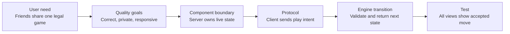

### Interview questions and answers

**Q: What is the first thing you do when asked to design an online game?**
**A:** Clarify the users, core actions, correctness rules, privacy needs, expected usage, failure behavior, and constraints. Then separate functional requirements from quality attributes. For Sevens, the must-have is not “use WebSockets”; it is “four people can play the same legal game while hidden hands stay private.” WebSockets are one way to satisfy the real-time communication requirement.

**Q: How would you decide whether to add persistent storage?**
**A:** Ask whether games must survive a process restart, whether players expect to resume later, and whether a business requirement needs a history. This version stores room state in memory and documents the restart limitation. If resumability becomes important, persistence becomes a requirement rather than an assumed improvement.

---

## 2. The high-level architecture

High-level design identifies the major parts of a system and the responsibilities between them. Sevens uses a browser client, an authoritative real-time server, and a pure game engine shared as a workspace package.

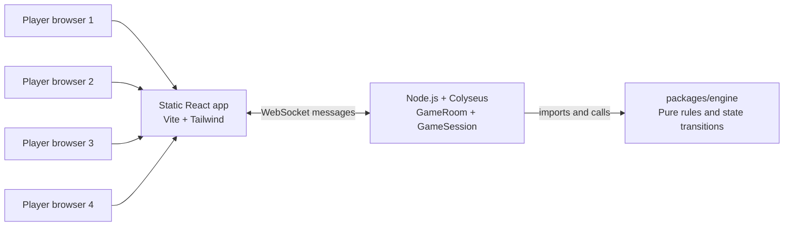

The browser files are served as static assets. Each browser opens an outbound WebSocket connection to the server. The server holds the room and game state and imports the engine to calculate the result of a move. There is no peer-to-peer connection between players.

### Why split the engine from the server?

The engine is a TypeScript package with no runtime dependencies. It can run in the server and in tests without starting Colyseus or a browser. The engine owns concepts such as legal moves, scoring, turn plans, and round transitions. The server owns sockets, timers, room membership, and reconnect handling. The browser owns rendering and user interaction.

In plain terms: the **engine is the rules referee**, while the **server is the online host**. The engine can answer, "Is `8H` legal on this table?" It does not know who is connected, which phone sent the request, or how to send a response. The server knows those online details, but asks the engine to decide the rules. The React browser draws the cards and collects taps; it should not be trusted to declare the move legal.

Imagine replacing Colyseus with another networking library. The way the server accepts a socket might change, but `scoreHand` should still score a hand the same way. That is the practical value of the boundary: network code can change without rewriting the card rules. Conversely, a rules change can be tested in the engine without booting a browser or opening four WebSocket connections.

This boundary reduces accidental duplication. If legality were independently reimplemented in React and Node, the two versions could disagree. With one engine, the server makes the decision and the browser can display the server-provided legal cards.

### Why a monorepo?

The root uses npm workspaces for `packages/*` and `apps/*`. In one repository, the engine API and its consumers can change together. Workspace dependencies such as `@cardgame/engine: "*"` resolve to the local package during development and installation.

The tradeoff is that one repository also shares a lockfile, tooling, and release history. Large teams may later need more granular ownership, package publishing, or independent deployment pipelines. A monorepo does not mean every component must deploy together: the static site and server already have separate Render services.

For example, if `PlayerView` gains a field, the engine type, server serializer, and web reducer can be reviewed in one change. npm workspaces make `@cardgame/engine` resolve to the local package, so the server does not need to download a separately published engine release for every edit. The cost is that a careless root-level change can affect both apps; workspace boundaries organize code, but do not make every change independent.

### Interview questions and answers

**Q: Why not put all the logic in the React app?**
**A:** A browser is controlled by the player. They can alter the JavaScript, forge messages, or skip UI checks. The browser is a presentation and intent-sending client, not a trusted authority. Rules must be enforced on the server.

**Q: Why have an engine package instead of writing game rules directly inside `GameRoom`?**
**A:** It separates deterministic domain behavior from I/O and framework behavior. The engine is easier to test and reuse. Colyseus-specific code can change without rewriting scoring and legality.

**Q: What is the cost of this separation?**
**A:** More package boundaries, imports, and public types to maintain. A boundary is useful when it protects a real responsibility; excessive tiny packages would add friction without enough benefit.

---

## 3. HLD versus LLD: the same system at two zoom levels

HLD is the map of major components. LLD explains how an individual component behaves and how its code is structured.

| Question | HLD answer | LLD answer in this project |
|---|---|---|
| Who decides a move? | The authoritative server. | `GameSession.handlePlay` checks the seat and choice phase, parses the card, then calls engine `playCard`. |
| How are rules shared? | One game engine package. | Functions such as `getLegalMoves`, `getTurnPlan`, and `playCard`. |
| How is hidden information protected? | Send each player a tailored view. | `getPlayerView(state, seat)` copies only that seat's hand and exposes only permitted shared data. |
| How does the browser receive updates? | Persistent real-time channel. | Colyseus `Room.send`, `room.onMessage`, and typed callback handlers. |
| How is invalid JSON data handled? | Validate at the trust boundary. | Zod schemas in `apps/server/src/messages.ts`. |

An HLD diagram should show dependencies and responsibility. It should not try to include every helper function. An LLD sequence diagram can show one operation in more detail:

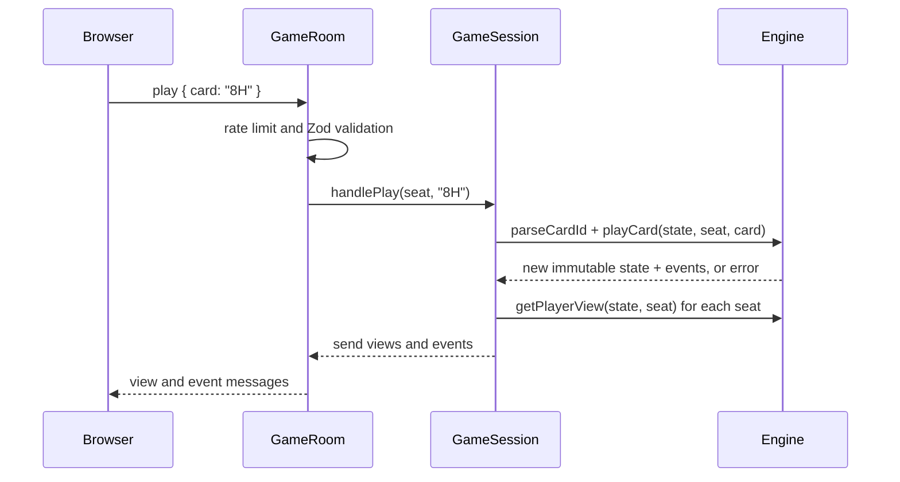

### How to draw useful diagrams

Start with the question a diagram is meant to answer. A component diagram answers “what talks to what?” A sequence diagram answers “what happens, and in which order?” A state machine answers “which transitions are allowed?” A deployment diagram answers “where does each process run?” Combining all of these into one picture usually makes it hard to read.

Use labels for trust boundaries and data ownership. An arrow labeled `play` is more useful than an unlabeled arrow because it states whether data is an intent or a result.

Here is the same move at two zoom levels. An HLD answer is: "The browser sends a play request to the authoritative server, which uses the engine and then broadcasts safe views." An LLD answer is: "The server parses `8H`, checks Mira's seat and turn, calls `playCard`, replaces the state only on success, then calls `getPlayerView` for each seat." Neither answer is more correct; they answer different questions. Start with the first in an interview and zoom in when asked how validation works.

### Interview questions and answers

**Q: When would you use a sequence diagram instead of a component diagram?**
**A:** Use a component diagram to explain static responsibilities and dependencies. Use a sequence diagram when timing, order, validation, retries, or ownership during one operation matter. For a card play, order matters because the server validates before publishing a new view.

**Q: What belongs in HLD and what belongs in LLD?**
**A:** HLD identifies services, storage, communication, and major ownership. LLD describes interfaces, state transitions, validation, data structures, and failure paths inside one service. The boundary depends on the audience; in an interview, start at HLD and zoom in where the interviewer asks.

---

## 4. Domain modeling and a pure game engine

Domain modeling means representing the problem in names and types that match the rules. Sevens uses `Card`, `Suit`, `Rank`, `Seat`, `Run`, `TableState`, `GameState`, and `PlayerView` rather than passing loosely structured objects throughout the app.

### State and legal transitions

`GameState` holds four hands, the table runs, current seat, phase, totals, round scores, winner, and count-only low-card hints. A suit run has a low and high rank. A `null` run means its seven has not opened that suit.

The round lifecycle is:

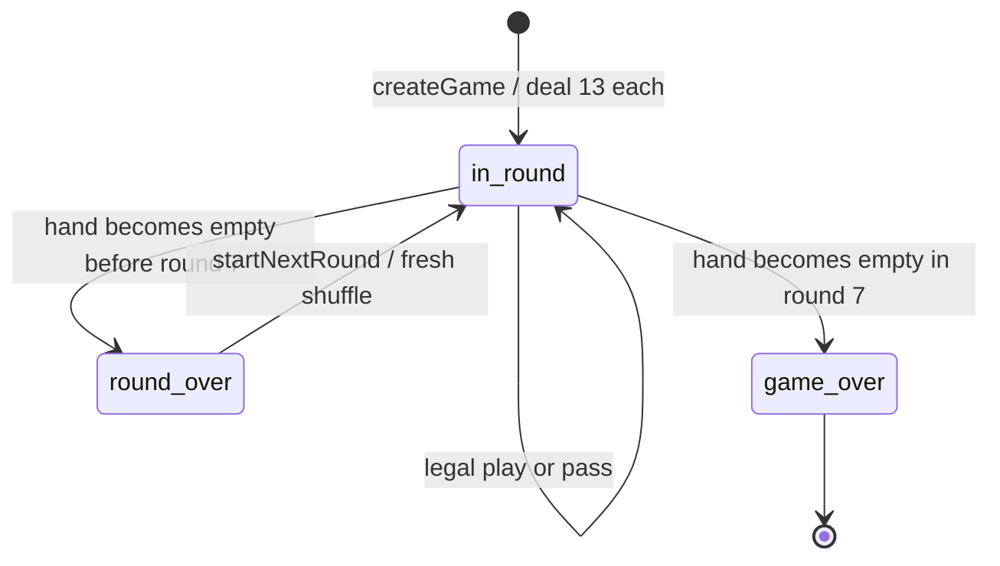

The engine defines the actual transition functions. For example, `playCard` checks phase, current seat, card ownership, and legality. If the hand becomes empty, it calculates the round score and totals immediately. `startNextRound` accepts only a `round_over` state.

Read the arrows as permissions. `in_round --> round_over` happens when a hand empties; `round_over --> in_round` happens only when the server starts the next round. A card play does not jump directly from `game_over` back into a new round. This picture is useful when checking whether an API operation is valid in a given phase.

Concrete example: before Mira plays, the heart run is `{ low: 7, high: 7 }`, `currentSeat` is Mira, and her hand contains `8H`. After `playCard`, the old state still describes the old board; the returned state has `high: 8`, no `8H` in Mira's hand, and the next turn plan. Trying to play `9H` from that original state must fail and leave the original state untouched. Thinking in terms of "state plus allowed transition" makes it much easier to ask what a function is allowed to change.

### Pure functions and immutability

A pure function returns the same output for the same input and does not change state outside the function. The engine uses an injected random-number function for shuffling, which makes randomness an explicit input. The seeded `mulberry32` generator makes tests repeatable; production code uses `secureRng`.

The engine returns new objects instead of mutating the old state. This makes transitions easier to inspect and test. It also makes it safe for the server to compare old and new references when deciding whether a scheduled action still applies.

Immutability is not the same as persistence. A new `GameState` in memory is still lost when the process exits. It only means the function preserves its input and returns a new value.

One useful test is to save the input reference, call `playCard`, and then check the input still has `8H` and the old heart high rank. The result should have the card on the table and the new high rank. This is like keeping a photograph of the old board before making the next move. It makes bugs easier to reproduce, but if the Node process crashes, both the old and new in-memory objects disappear; a database or replay log would solve a different problem.

### Determinism and RNG injection

Determinism is valuable for simulations and bug reproduction. A test can initialize a game with a fixed seed and replay the same choices. Production still needs unpredictable shuffling, so the engine accepts an `Rng` rather than hard-coding a seeded generator.

The seed is not a promise that every platform implementation will remain byte-for-byte compatible forever unless the RNG algorithm and version are treated as a stable contract. For long-term replay compatibility, record the RNG algorithm/version, seed, and inputs or record events.

Suppose a simulation fails on seed `217`. You can run seed `217` again, receive the same shuffle, and inspect the same sequence of moves. If the engine secretly called `Math.random()`, the test could fail differently on each run and the seed would not control the full deal. Production uses a secure random source because a predictable seed would let someone guess cards. The interface is the same (`Rng`); only the source of random values changes.

### Interview questions and answers

**Q: Why keep the game engine free of network and framework code?**
**A:** Pure domain code can be tested quickly without sockets, timers, or a browser. It also makes the same rule implementation available to simulations and server orchestration. Side effects stay in the layer that owns them.

**Q: What does immutability buy us, and what does it not buy us?**
**A:** It helps prevent accidental changes to old state and makes transitions easier to reason about. It does not provide a database, crash recovery, distributed consistency, or a security boundary by itself.

**Q: Why inject an RNG?**
**A:** It separates random behavior from rule behavior. Tests can use a deterministic source, while production can use cryptographic randomness. A fixed seed also makes many failures reproducible.

---

## 5. Authoritative state and hidden information

The server's `GameState` is authoritative: it decides the truth. The browser sends an intent such as “play 8H,” not a claimed new game state. The server checks that intent against its own state and publishes the accepted result.

This pattern is sometimes called server authority or authoritative simulation. It is common in multiplayer games because clients can be modified or dishonest. It also means a player with a slow connection may briefly see stale state; when a fresh server view arrives, that view wins.

### Tailored views

The server must not send the whole `GameState`, because that object contains every hand. Instead, for each seat, it calls `getPlayerView(state, seat)`. A view contains that player's hand, legal card IDs if it is their turn, shared table data, hand counts, totals, and permitted hints. It never contains other hands.

This is a form of data minimization: do not send secrets and then rely on the UI to hide them. The server's output shape itself should not contain the secret.

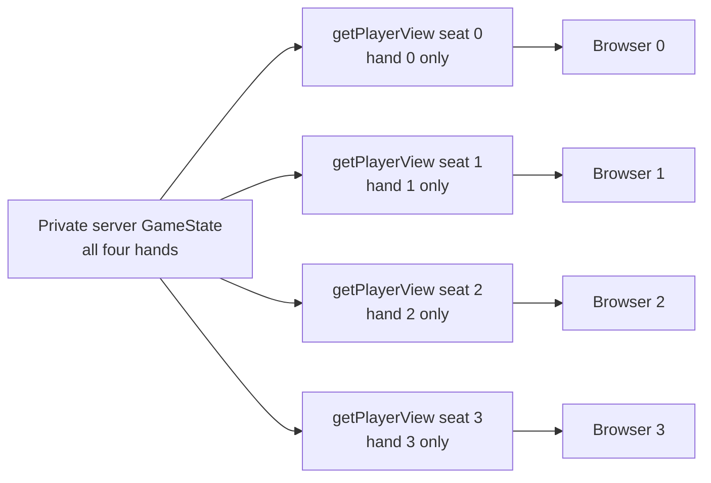

At round end, other hands are still hidden. The server sends scores and hand counts, not the card identities. If a future game design reveals hands after a round, that should be a deliberate protocol change with tests.

For example, the private server state might contain `Mira: [8H, 2C, ...]` and `Asha: [9H, 4D, ...]`. Mira's view can include Mira's cards, Asha's hand count, and the shared suit runs; it must not include `9H` or `4D`. Merely drawing card backs over Asha's cards in React would not protect them: Mira could inspect the WebSocket payload in developer tools. The safest hidden value is one the server never sent.

### Trust the source, validate the intent

The browser can highlight the `legalCards` array for a helpful interface, but that is not authorization. A malicious client can send any string. The server first validates the message shape and then asks the engine whether the move is legal in the current authoritative state.

Picture a modified browser sending `play { card: "7H" }` while it is Asha's turn. The JSON is perfectly well formed, so schema validation alone accepts its *shape*. The server's session-to-seat mapping then says the sender is Mira, and the engine/session turn check rejects the *action*. Shape validation answers "does this look like a play message?" Authorization and game rules answer "may this player do this now?"

### Interview questions and answers

**Q: Why not broadcast the entire state and let each client hide opponents' hands?**
**A:** Any player can inspect network messages and browser memory. Hiding a field visually does not make it private. The server should construct a per-player projection that does not include other players' card identities.

**Q: What if the client sends a move that the UI says is legal, but it is not legal on the server?**
**A:** The server rejects it and does not advance state. The client should render the next authoritative view and display an error if needed. Client-side validation is a usability hint, not a security control.

**Q: Is a tailored view enough to secure the application?**
**A:** It protects this particular hidden-information channel, but security also requires authentication/seat binding, validation, rate limits, safe room access, and careful error handling. No one design choice solves all security problems.

---

## 6. Real-time communication and protocol design

The client and server communicate over Colyseus rooms using WebSocket messages. A WebSocket provides a long-lived, bidirectional connection. Unlike repeated HTTP polling, the server can push updates as soon as state changes.

### Messages describe intents and facts

Client-to-server messages are commands or intents:

| Message | Meaning | Server checks |
|---|---|---|
| Join options | Create or join a room with a display name and optional code. | Name length, code format, code match, free seat. |
| `start` | Ask to start the game. | Host identity, lobby phase, four seated players. |
| `play` | Ask to play a card ID. | Message schema, seat, turn, choice phase, card ownership, rule legality. |

Server-to-client messages are facts or snapshots:

| Message | Meaning |
|---|---|
| `lobby` | Public room code, host seat, players, and connection status. |
| `view` | A safe player-specific snapshot. |
| `event` | A notable event such as card played, pass, round won, or round started. |
| `error` | A rejected request or other protocol error. |

This separates command from event. `play` says “please attempt this.” `card_played` says “the server accepted that a card was played.” A client should not treat its own command as proof that the state changed.

```mermaid
sequenceDiagram
    participant M as Mira's browser
    participant S as Server
    participant E as Engine
    M->>S: play { card: "8H" }
    S->>S: Check message shape and Mira's seat
    S->>E: Try playCard(currentState, Mira, 8H)
    alt Legal move
        E-->>S: New state + card_played event
        S-->>M: Updated private view + event
    else Illegal or out of turn
        E-->>S: Error; original state remains
        S-->>M: Error + current view
    end
```

The key property in this sequence is that the browser sends a *request*, while the server sends back the *result*. If the engine returns an error, the state update and view broadcast should not happen. That is why the sequence places validation before state publication.

### Schema validation is a boundary

`messages.ts` uses Zod to validate network input. Schemas restrict names, room code format, card IDs, allowed object keys, and numeric ranges. The word **strict** is important: an unexpected field is rejected rather than silently accepted. This catches mistakes and prevents accidental expansion of the API surface.

Typescript types help code at compile time; they do not validate untrusted JSON at runtime. A malicious client can send data that ignores the TypeScript definitions, which is why runtime schema validation is required.

For example, a normal client sends `{ "card": "8H" }`. A modified client could send `{ "card": { "rank": 8, "suit": "H" }, "makeMeHost": true }` or an extremely long string. The browser's TypeScript type does not stop either payload from crossing the network. Zod checks the real received value and can reject the wrong shape, unknown field, or invalid card ID before the game session handles it.

### Snapshots plus events

The server sends views as snapshots of the current state and events as notable changes. A snapshot is easier for a newly connected client to render without replaying the entire game's history. Events are useful for short-lived effects such as a toast.

There is a tradeoff: an event stream without sequence numbers can be hard to reconcile after a network gap. This version's current view is the recovery mechanism. For stronger ordering and resume behavior, add a monotonically increasing `stateVersion` or event sequence to views and events. A client can then ignore stale messages or request a fresh snapshot.

Suppose the client receives a `card_played` event saying Mira played `8H`, but the connection drops before it receives the next view. The event can explain what happened, but it does not contain Mira's complete hand, score, turn, and all four table runs. On reconnect, a fresh `view` can redraw the whole screen. If messages later carry `stateVersion: 42`, then a delayed version 41 view can be recognized as stale instead of replacing newer data.

### Protocol evolution

As a system grows, multiple web versions may be online while a server deploy changes the protocol. Versioning options include:

1. Add optional fields with backward-compatible defaults.
2. Keep old message forms accepted for a migration period.
3. Add a protocol version during join and explicitly reject incompatible clients.
4. Use generated types or shared schemas to reduce drift between the server and browser.

The current web side duplicates some message interfaces as TypeScript types to avoid importing the server package. This is small and simple, but it can drift. A future improvement could put protocol schemas/types into a small shared package, or generate client types from a schema, while keeping server-only validation code private.

### Interview questions and answers

**Q: Why WebSockets instead of ordinary HTTP requests?**
**A:** The game has frequent, low-payload updates in both directions. WebSockets keep a bidirectional connection so the server can push state changes. HTTP still makes sense for health checks, static files, and many ordinary request/response APIs.

**Q: Why send both snapshots and events?**
**A:** Snapshots give the client a complete renderable state; events give it contextual changes for toasts or animation. Snapshots help recover from missed events. If event ordering or replay becomes important, sequence numbers are needed.

**Q: Why isn't a TypeScript interface enough to validate a WebSocket message?**
**A:** TypeScript types are erased at runtime. JSON received from a network peer is untrusted data. A runtime validator such as Zod checks the actual value before application logic uses it.

---

## 7. Low-level game orchestration: turns, timers, and races

The game engine calculates what should happen. The server orchestration decides when to call it and how to interact with connected players.

The engine returns one of three turn plans:

- Exactly one legal card: `auto_play`.
- No legal cards: `auto_pass`.
- Multiple legal cards: `await_choice`.

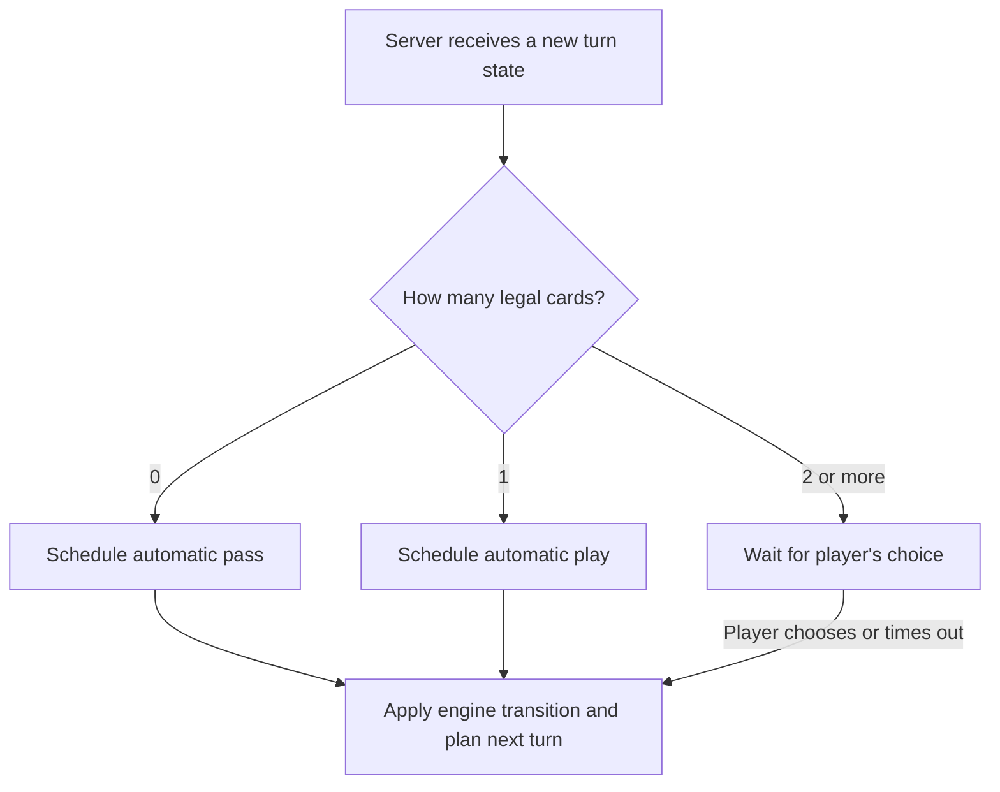

The `GameSession` schedules automatic actions and player timeouts. An auto-play or auto-pass waits the configured delay so it can be seen. An `await_choice` turn waits for a client move or times out. When a choice times out, the server's policy selects the highest-ranked legal card. A disconnected seat becomes bot-controlled after the reconnect window.

### Why timers need cancellation and stale-state checks

Suppose the server schedules a timeout for seat 2. Before it fires, the player reconnects or makes a valid move. The old timer must not apply an action to the newer state. `GameSession` cancels action timers and checks that the game state reference still matches the state captured when a timer was scheduled.

This illustrates a general asynchronous-programming hazard: a callback can run later than the conditions that created it. Reliable systems make callbacks re-check their assumptions before committing a change.

Timeline example: at 12:00:00 the server starts a 30-second choice timer for seat 2. At 12:00:12, seat 2 plays a legal card and the server advances to seat 3. At 12:00:30, the old callback wakes up. Without cancellation or a current-turn check, it might auto-play for seat 2 during seat 3's turn. A timer is a delayed message from the past; before acting, it must prove that the turn it was created for is still current.

```mermaid
sequenceDiagram
    participant S as Server timer
    participant P as Player seat 2
    participant E as Engine
    S->>S: Start choice timer for turn 12
    P->>S: Play a legal card at 12 seconds
    S->>E: Apply player's move
    E-->>S: New state; turn 13
    S->>S: Cancel timer for turn 12
    Note over S: If stale callback still runs, verify turn ID/state before acting
```

### State machines make behavior reviewable

The phase field (`in_round`, `round_over`, `game_over`) prevents operations from being applied in the wrong stage. The engine returns `WRONG_PHASE` instead of trying to infer what the caller meant. A state machine is often clearer than a collection of booleans such as `started`, `roundFinished`, `lastRound`, and `isGameDone`, which can form contradictory combinations.

Think about the interval after a round ends but before the next starts. The table is showing results. A `play` request in that interval should return `WRONG_PHASE`; a next-round transition should be allowed only in the appropriate phase. One named phase makes the allowed actions visible. With booleans, a bug might accidentally set both `roundFinished = true` and `started = false` without anyone knowing which operation is valid.

### Interview questions and answers

**Q: How would you prevent a timeout callback from playing after a player already acted?**
**A:** Cancel the timer when the action is accepted and make the callback verify that it still corresponds to the current turn/state before applying anything. Cancellation reduces wasted work; revalidation protects against races where cancellation arrives too late.

**Q: What does a state machine contribute here?**
**A:** It names valid phases and transitions. This makes it possible to reject a `play` during `round_over` and restrict `startNextRound` to the correct phase. It also makes tests target transitions instead of a large set of loosely related flags.

**Q: Why does the server choose a timeout card?**
**A:** The game must keep moving when a player does not respond. A deterministic policy based on legal options ensures the selection remains legal and is testable. The policy can later be replaced by a different bot strategy without changing rule legality.

---

## 8. Room identity, matchmaking, and lifecycle

A room groups four connected seats into one game session. The first player to join gets seat 0 and is the host. Seats remain fixed through the game. The room code is a five-character string generated from an alphabet that avoids ambiguous characters such as `0`, `O`, `1`, and `I`.

### Uniqueness and scope

`roomCode.ts` keeps a set of reserved codes in process memory. It normalizes input to uppercase and releases the code when the room is disposed. This is enough for one Node process: the set prevents two active rooms in that process from colliding.

If the service scales to multiple Node instances, each instance has its own set. A code could be generated simultaneously on two machines. The system would need a shared uniqueness authority, such as a database unique constraint or a distributed matchmaker. Room IDs must also route the join request to the process that owns the room.

For a concrete collision, server A and server B both have no knowledge of each other's local `Set`. At nearly the same moment, each generates `AB7KD`. Locally each believes the code is free, but globally two rooms now share it. A shared store with an atomic "claim this code only if unused" operation can decide which server wins. This coordination has a cost, so it is unnecessary while one process owns all rooms.

### Capacity and lifecycle

The room accepts at most four clients. Before the game starts, a departing player frees a seat and the host can be recomputed. After the game starts, seat identity is preserved so scores and turn order do not change when a connection drops. Empty rooms are disposed and their code is released. A completed game remains open for a short configured linger period before disconnecting clients.

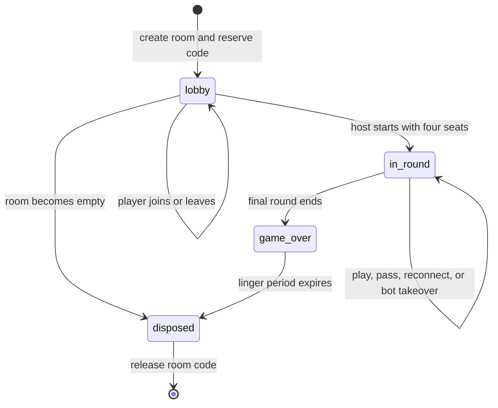

This lifecycle diagram also explains why a room code should be released on disposal: it is a temporary address for a live room, not a permanent player identity.

### Why not build a separate matchmaking service now?

For four players joining by a known code, Colyseus's room/matchmaker responsibilities are sufficient. A separate service would add deployment and operational work. A dedicated matchmaking service becomes more useful when players need public queues, region selection, skill matching, party formation, or large-scale room discovery.

### Interview questions and answers

**Q: Is a random room code automatically secure?**
**A:** No. It makes guessing harder, but it is not a replacement for authorization, rate limiting, expiry, or careful access control. The server also validates the supplied code and limits room capacity. If rooms become sensitive, add stronger join authorization and abuse monitoring.

**Q: Why does local in-memory uniqueness fail when scaling horizontally?**
**A:** Each process sees only its own memory. Two processes can independently choose the same code. A shared store or matchmaker must coordinate allocation, and the system needs a routing mechanism to find the owning room.

**Q: When would you add public matchmaking?**
**A:** When users need to find a game without already knowing a room code, or when queue policies such as region and skill become requirements. It is not needed just because the app has multiplayer.

---

## 9. Security and abuse resistance

Security design starts with trust boundaries. In Sevens, the browser is an untrusted network peer. The room's server code is trusted to validate messages, enforce state transitions, and limit what each player sees.

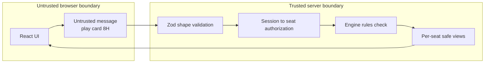

Each gate answers a different question: is the message shaped correctly, does this connection own the seat, is the move legal, and what data is safe to return?

### Controls present in this project

- Zod validates room join options and gameplay messages.
- The server maps each Colyseus session to an assigned seat; clients do not choose arbitrary seats in `play` messages.
- The game engine checks turn ownership, phase, hand ownership, and card legality.
- Per-client message buckets limit message volume per second.
- Room codes are generated with `crypto.getRandomValues`, normalized, and released on disposal.
- CORS is configured for allowed browser origins, with `CLIENT_ORIGIN` used for deployment.
- A player view only includes that player's own hand.

### CORS is not authentication

Cross-Origin Resource Sharing (CORS) is a browser policy that controls which web origins may read responses. It does not prevent a non-browser client from connecting, and it does not prove that a player is allowed to act. Authorization still comes from room membership, the server's session-to-seat mapping, and game-state checks.

Example: if the deployed site is `https://sevens-web.onrender.com`, the server can allow that origin for browser requests. This does not stop a command-line program from opening a socket, because command-line programs do not have to obey browser CORS rules. The server still needs to reject a `play` from a session that does not own the acting seat. CORS controls which browser pages may read; it does not grant game permissions.

### Rate limiting and input limits

Rate limiting protects CPU and bandwidth from clients that send too many messages. Input validation protects parsers and business logic from malformed or oversized values. A production system should also consider limits for connection attempts, room creation, reconnect attempts, and per-IP abuse. The correct thresholds depend on observed traffic; too low a threshold blocks legitimate players on shared networks.

Suppose a phone reconnects and sends a join message, then retries because mobile data is slow. A limit that allows only one message total could lock out a real player. A sensible rate limiter allows ordinary retries and card taps while slowing a client that sends hundreds of messages every second. Measure normal traffic first, and distinguish a short burst from sustained abuse where possible.

### Threats to consider as the project grows

- Room-code brute force or room enumeration.
- Message floods or oversized payloads.
- Reconnect-token theft from a shared device or cross-site script injection.
- Denial of service from opening many rooms.
- Dependency vulnerabilities and exposed secrets.
- Abuse of error messages to discover room or player state.
- A compromised server process, which can see every hand.

This first version does not implement accounts. A reconnect token identifies a previously joined room session, but it is not a full user identity system. If accounts or purchases are added, identity and authorization need a separate design.

### Interview questions and answers

**Q: What is the difference between validation and authorization?**
**A:** Validation asks whether input has an acceptable shape and value, such as whether `card` matches `13D`. Authorization asks whether this particular player may perform the action now, such as whether their seat owns the current turn. Both are needed.

**Q: Does CORS stop someone from calling the server with a script?**
**A:** CORS constrains browsers, not arbitrary clients. It is not an authentication or authorization mechanism. The server must validate and authorize every action regardless of the origin.

**Q: What would you monitor before tightening rate limits?**
**A:** Message counts by type, legitimate peak action patterns, rejected messages, connection retries, and abuse indicators. Then set limits that protect the service without penalizing normal mobile reconnect behavior.

---

## 10. Reliability, reconnects, and failure behavior

Networks fail in ordinary ways: a phone changes from Wi-Fi to mobile data, a browser tab sleeps, the user moves through a tunnel, or the server restarts. Real-time systems need to decide what state survives each failure.

### Current reconnect approach

The web client stores a Colyseus reconnection token in `sessionStorage` and attempts to reconnect on app startup and when the page becomes visible after a hidden period. The server marks a dropped seat disconnected, allows reconnection for a configured window, then converts the seat to a bot if the window expires. The bot selects from legal options, so the engine remains the legality authority.

This approach preserves the room if the server process and room still exist. It does not preserve the game if the server process restarts, because active room state is in memory.

Example: Asha is playing on a train. Her connection drops for 8 seconds while the Node process stays alive. The browser presents its reconnect token, the same room still remembers Asha's seat, and it can send her the latest view. If the host redeploys the server while she is offline, the room memory disappears; the token cannot reconstruct the shuffled deal by itself. Reconnection and durable recovery solve different failure cases.

### Failure categories

| Failure | Current behavior | Possible later improvement |
|---|---|---|
| Browser temporarily loses network | Reconnect token and room reconnection flow. | Show reconnect progress, retry with backoff, and explain when recovery expires. |
| Player remains offline | Server takes over the seat with a bot after the grace period. | Let host choose policy, or allow a player to rejoin under a verified identity. |
| Server process restarts | In-memory rooms are lost. | Persist checkpoints/events or move live room ownership to a durable clustered service. |
| A message is duplicated | State/phase/turn checks reject many stale actions. | Add command IDs and idempotency tracking for operations where duplicate execution is dangerous. |
| A timer fires late | Callback checks current state and phase before acting. | Use explicit turn/version IDs for more robust stale-timer detection. |

The table can be read as a small recovery map:

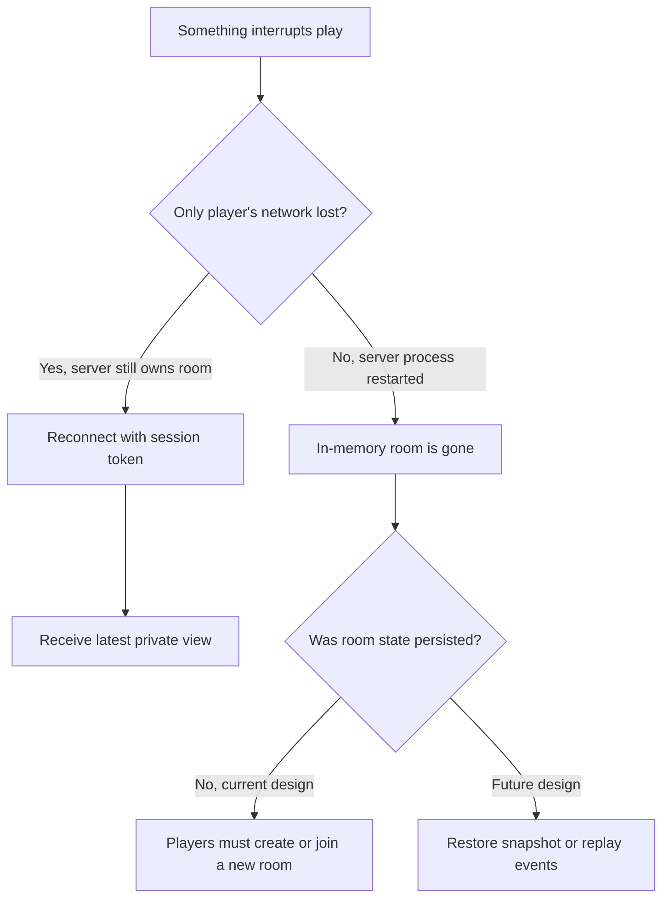

This makes an important boundary visible: reconnect can restore a connection to a surviving room; persistence is what could restore the room after its owner process disappears.

### Retries and idempotency

Retries are common in unreliable networks. If a client sends a command and does not receive a response, it may not know whether the server accepted it. For card plays, the server's current turn and hand checks generally prevent the same card from being played twice. More complex operations, such as purchases, need a unique request ID and a stored result so retrying does not charge twice.

### Interview questions and answers

**Q: What is the difference between retrying and idempotency?**
**A:** Retrying repeats a request after uncertainty. Idempotency means repeating the same request has no additional effect beyond the first successful execution. A system often needs idempotency to make retries safe.

**Q: Does reconnect support mean the game is durable?**
**A:** No. Reconnect works while the owning room still exists. Durable recovery across process loss needs a persistence or reconstruction mechanism.

**Q: Why use a bot after a reconnect window?**
**A:** It allows the other players to keep playing rather than waiting forever. The tradeoff is that an absent player can lose strategic control. A product might offer pause, host choice, or a longer grace window depending on playtest feedback.

---

## 11. Browser architecture, rendering, and mobile performance

The browser app has screens for home, lobby, table, round summary, and game over. `App.tsx` connects network callbacks to a reducer in `state/gameState.ts`. Components render the current view and dispatch user actions to the network client.

### Why a reducer?

A reducer is a function from `(oldState, action)` to `newState`. It centralizes transitions for lobby updates, player views, toasts, connection status, and reset behavior. It avoids unrelated components independently mutating shared client state.

For example, a server message arrives with `type: "view"`. The app dispatches `viewReceived(view)`; the reducer returns a new UI state containing that view. A toast event dispatches a different action and may update the toast field without accidentally wiping the hand. If every component directly edits shared state, a player-card component could change connection status or an out-of-order lobby update could erase a newer game view.

### Render from the server view

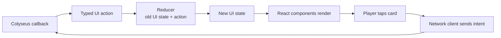

The table highlights cards from `view.legalCards`; it does not decide legality. When a player clicks a card, the browser sends its ID. This keeps presentation and authority separate. It also makes the browser simpler: it can focus on clarity and accessibility rather than duplicating every rule.

### Mobile design is a system constraint

The table must fit a narrow viewport while showing opponent status, four suit runs, and the player's hand. The app uses CSS variables and viewport-height breakpoints to adjust card sizes and stack spacing. Real card art is WebP, and opponent mini backs are CSS shapes rather than dozens of repeated image downloads.

Performance here is not just CPU speed. It includes:

- **Network payload:** smaller WebP assets reduce first-load transfer.
- **Layout stability:** explicit image dimensions reserve space before art loads.
- **Touch usability:** controls retain practical touch sizes.
- **Viewport fit:** the table should remain usable without accidental page scrolling.
- **Rendering work:** only visible game state changes need to update components.

The card-art work gives a useful concrete example. A large SVG face repeated across the hand and table costs more to download and decode on a phone with a slow connection. Converting the source artwork to small WebP files reduces transfer size. Explicit `width` and `height` on each image reserve its rectangle before decoding, so the hand does not jump when the image appears. These are system-design choices because the network and device affect whether the interface feels responsive.

### Accessible controls

Icon-only controls need accessible names such as `Enter fullscreen` and `Exit fullscreen`. A visible symbol alone may not be meaningful to a screen reader. Buttons should also have visible focus styles, sufficient contrast, and usable touch targets.

### Interview questions and answers

**Q: Why should the client not duplicate server-side legality rules?**
**A:** Duplicated rules drift. The client may use server-provided legal options for highlighting, but the server makes the final decision. If the client needs optimistic interaction later, it should still reconcile with authoritative state.

**Q: Why are image dimensions useful even if the browser knows the asset's size?**
**A:** Explicit dimensions reserve layout space before the image is decoded, reducing layout shift. They also make the intended card geometry visible in markup and easier to reason about.

**Q: What is a good way to handle a visual preference like fullscreen?**
**A:** Treat it as progressive enhancement. Use the browser API when supported, provide a clear fallback message when it is not, and do not make core gameplay depend on fullscreen support.

---

## 12. Scaling: what changes after one server is not enough?

The current design is intentionally small: one Node process owns each live room, and all room state lives in memory. This avoids distributed coordination. It is a good starting point for a small game, but it creates a clear scaling boundary.

### Horizontal scaling problem

Running two server instances does not automatically make a single room available on both. If player 1 connects to instance A and player 2 to instance B, each process would otherwise have a different copy of the room. They could disagree about the current turn, cards, and scores.

There are two broad ways to solve this:

1. **Room affinity:** route every connection for a room to its owning server instance. A matchmaker or shared room registry provides the mapping. The room still has one authority.
2. **Distributed state/coordination:** share room data and coordinate writes. This is harder because two workers must not accept conflicting moves as if each were authoritative.

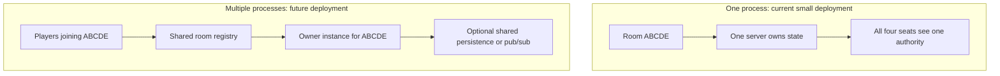

For turn-based games, room affinity with one owner per room is usually easier than making every server concurrently mutate a room. Shared infrastructure may still be used for room lookup, pub/sub, and recovery.

Imagine one room has Mira, Asha, Ben, and Dev. If Mira's `play 8H` reaches server A but Asha's next action reaches server B with an old copy of the table, both servers might believe it is their turn. With room affinity, all four sockets for that room go to the one process that owns it. Adding more servers then increases the number of rooms the system can host, while each individual room still has one rule authority.

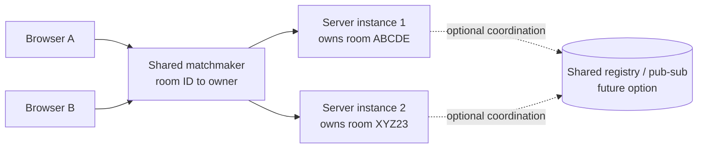

### Database choices should follow requirements

The app currently has no database. If the requirement becomes “recover the game after a crash,” possible designs include:

- Periodic snapshots of `GameState` to a database or object store.
- An append-only event log and replay from a known initial seed/deal.
- A snapshot plus a short event tail, balancing recovery time and write volume.

Event sourcing is not automatically better. It adds event schema evolution, replay logic, and operational complexity. For a game whose active state is small, snapshots may be simpler. Event logs are useful when auditability, replay, or detailed history is valuable.

For example, a snapshot might save "round 3, seat 1's turn, these suit runs, these four hands, these totals." An event log might instead save `round_started`, `card_played(7H)`, `passed(seat 2)`, and replay each event to rebuild the state. A snapshot is quick to load but must be written safely; replay provides history but every old event format must remain understandable. The requirement "survive a crash" does not by itself tell us which mechanism is better.

### Capacity estimates

Before scaling, estimate load. Suppose there are `R` active rooms and four connected clients per room. Then active connections are approximately `4R`. If each accepted turn sends one view and a few events to four clients, estimate outbound messages per action and total bytes per second. Measure realistic payload sizes rather than guessing.

Useful metrics include active rooms, active sockets, messages per second, payload bytes, event-loop delay, memory per room, reconnect frequency, and timeout frequency. Scale based on measured bottlenecks, not only on player count.

### Interview questions and answers

**Q: Why can't you just put a load balancer in front of two game servers?**
**A:** A load balancer distributes connections, but a live room's state belongs to one process. Requests for the same room must route to that owner or share a carefully coordinated state model. Load balancing alone can split the room into inconsistent copies.

**Q: Would you choose Redis or a relational database?**
**A:** Start from the requirement. Redis can help with ephemeral room routing, locks, or pub/sub. A relational database may suit durable room records or player/account data. Neither choice should be made just because it is popular; consistency, durability, query needs, and operations matter.

**Q: How would you know when to scale?**
**A:** Define capacity metrics and latency targets, load test, and inspect CPU, memory, event-loop delay, socket counts, and traffic. Then identify the limiting resource. Adding instances before understanding the bottleneck can add complexity without improving the user experience.

---

## 13. Deployment and configuration

The repository deploys the browser app as a static site and the Node server as a web service through `render.yaml`. The browser is built with Vite. The server exposes `/health` and listens on the platform's `PORT` on all network interfaces.

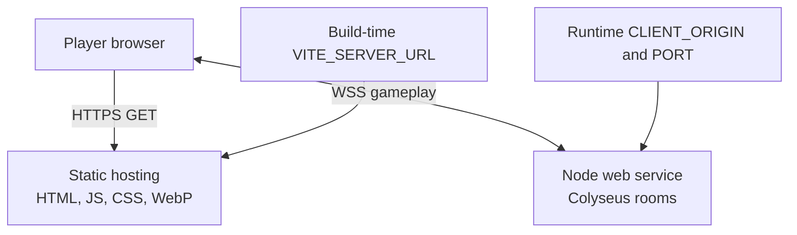

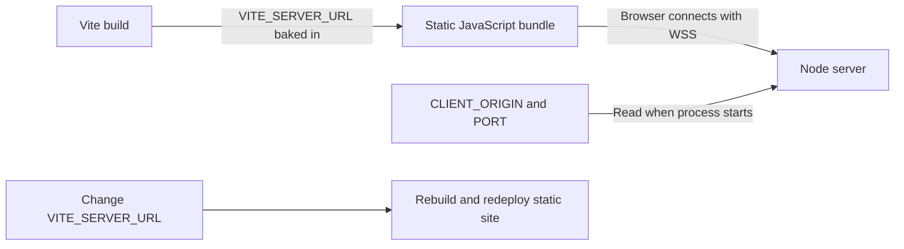

### Build-time and runtime configuration

`VITE_SERVER_URL` is embedded into the static browser bundle during build. Changing it in hosting settings does not rewrite already-built JavaScript; redeploying the static site is required. `CLIENT_ORIGIN` is read by the running server to set allowed web origins. `PORT` is supplied by the hosting platform and must be used by the server.

This distinction is important whenever an application has static assets and a separate API. Ask: is this value read while building files, or when the process starts?

Concrete deployment example: during `npm run build -w @cardgame/web`, Vite replaces `import.meta.env.VITE_SERVER_URL` with `wss://sevens-server.onrender.com`. The resulting JavaScript file contains that server address. Changing the environment variable in Render after the build does not edit the existing file; redeploying the static site rebuilds it. By contrast, `CLIENT_ORIGIN` is read when Node starts, so changing it restarts the server with a new allowlist.

### Health checks

`GET /health` returns `ok`, which tells the platform that the HTTP server can respond. A simple health check does not prove every dependency is healthy or that rooms are functioning. More mature systems often separate:

- **Liveness:** should the process be restarted?
- **Readiness:** should traffic be routed here right now?
- **Dependency health:** can the service reach required databases or queues?

Do not make readiness overly broad. If a noncritical third-party service is temporarily down, marking the whole game server unready may worsen an outage.

### Current production-start tradeoff

The server's production start script uses `tsx` to run TypeScript directly. This is a simple first deployment path and avoids a separate server compilation pipeline. A more conventional production setup would compile server and engine to JavaScript during the build and run `node dist/...`. That can reduce runtime tooling and catch build packaging issues before startup, but it requires correct workspace output paths and module packaging.

### Interview questions and answers

**Q: Why does a frontend environment variable sometimes require a rebuild?**
**A:** A bundler may substitute the variable into static JavaScript during the build. The deployed file contains the resulting value, not a live pointer to the server's environment. A new build is needed to change it.

**Q: Is `GET /health` enough to prove the service is healthy?**
**A:** It proves a narrow property: the process can handle that request. It may not prove that gameplay, storage, or external dependencies work. Define health endpoints based on what the platform needs to decide, and avoid treating every dependency failure as total process death.

**Q: Why might you compile TypeScript instead of running it with a TypeScript runner in production?**
**A:** Compilation can make production startup simpler and move errors into the build stage. Running through a TypeScript runner is convenient and can be acceptable for a small service, but adds runtime tooling and should be tested in the actual deployment environment.

---

## 14. Observability and operations

Observability is the ability to infer what a system is doing from its outputs. A game server needs enough evidence to answer questions such as “Why could this player not join?” or “Did the timeout occur before the disconnect?”

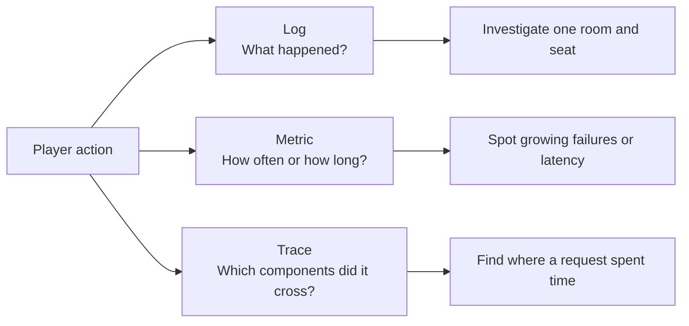

### Logs, metrics, and traces

- **Logs** describe discrete events: room created, join rejected, move accepted, reconnect started.
- **Metrics** count or measure patterns: active rooms, active clients, move latency, reconnect success rate.
- **Traces** show one operation across components: browser command through room, session, engine, and response.

The current service has a health route and application error handling, but not a full metrics or distributed tracing setup. For a first release, structured logs with room ID, seat, round, phase, and error code can make debugging much easier. Avoid logging card hands or other private state.

Suppose players report, "We got stuck after seat 3 disconnected." A log line with `room=AB7KD seat=3 phase=in_round event=reconnect_window_expired` gives an operator a starting point. A metric showing reconnect failures rising across many rooms tells them it is a wider problem. A trace can connect one particular join attempt from the WebSocket handler to the session logic. These are complementary clues: logs give detail, metrics show trends, and traces show a path across components.

### Correlation IDs

A client action and the server error it caused should be connectable without logging sensitive details. A request or message ID can be included in logs and in the error response. For multi-service systems, propagate a trace ID across boundaries.

### Useful game metrics

- Rooms created and disposed per minute.
- Players per room and rejected joins.
- Action counts by message type.
- Invalid message and illegal move counts.
- Turn timeouts and bot takeovers.
- Reconnect attempts, successes, and failures.
- Time from accepted action to broadcast view.
- Process memory, CPU, event-loop delay, and active sockets.

Metrics should be labeled carefully. A label containing a unique room code for every metric can create high-cardinality costs. Put room codes in logs/traces, not necessarily as metric labels.

### Interview questions and answers

**Q: What would you log for an illegal play without leaking a player's hand?**
**A:** Log a correlation ID, room identifier, seat, phase, current seat, error code, and message type. Do not log the full hand or payload if it contains sensitive information. Use aggregate metrics for trends.

**Q: What is the difference between a metric and a log?**
**A:** A metric is a numeric time series suited to trends and alerts. A log is an individual event with context. “Illegal move count increased” is a metric; “seat 2 sent an invalid card ID in room X” is a log event.

**Q: What would you alert on?**
**A:** User-visible failures and capacity risks: elevated join failures, reconnect failures, crash loops, event-loop delays, memory pressure, and high action latency. Alerts should be actionable and tied to an owner or response procedure.

---

## 15. Testing as a system-design tool

Tests are not just a final quality check. They make design assumptions explicit. Sevens tests the engine separately from server orchestration and the room protocol.

### Test layers

1. **Unit tests:** test an isolated function, such as scoring or card parsing.
2. **Domain transition tests:** create a state and verify play, pass, scoring, and phase transitions.
3. **Simulation/property-style tests:** play hundreds of seeded games and verify invariants after every move.
4. **Server session tests:** use fake timers to test timeouts, reconnect behavior, and bot takeover without waiting in real time.
5. **Integration tests:** start a Colyseus test server, connect four clients, send protocol messages, and verify full games and view privacy.
6. **Browser/build checks:** typecheck the web app and produce a production Vite build.

This is often drawn as a test pyramid: many cheap checks at the bottom, fewer expensive checks at the top.

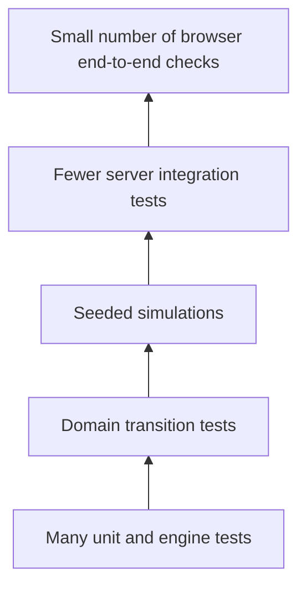

The pyramid is a guide, not a law. Sevens benefits from many fast engine tests because rules are pure, plus a smaller number of real four-client tests to prove the network wiring works.

### Invariants are stronger than examples

An example test says “this hand should produce these legal cards.” An invariant says “hands plus table always contain 52 unique cards.” Example tests check known cases. Invariants can catch unexpected combinations across many simulated games.

Important Sevens invariants include:

- Exactly 52 unique cards remain distributed between hands and the table.
- Each dealt hand begins with 13 cards.
- A round winner has a zero score for that round.
- Cumulative totals equal the sum of prior round scores.
- Only the current seat's view contains its hand.
- Every in-round state has at least one legal move somewhere, so the game cannot deadlock.

### Deterministic simulation

The 500-game simulation uses seeded RNGs. When a simulation fails, the seed helps recreate the same deal and sequence. This is an effective way to search a large state space for edge cases without making the test nondeterministic.

For example, a simulation can assert after every play that exactly 52 cards are accounted for across hands and the table. A bug that accidentally drops a card on move 37 of game seed 217 might never appear in a hand-written "play 7H" test. The seeded simulation finds it, reports the seed and step, and lets a developer replay that exact sequence while debugging.

### Test what can fail at the boundary

The protocol has untrusted input, so test malformed fields, unknown fields, invalid card IDs, and wrong message phases. Reconnect behavior needs fake-time tests because timers and network lifecycles are a frequent source of race conditions.

### Interview questions and answers

**Q: What is the difference between a unit test and an integration test?**
**A:** A unit test isolates a small behavior and replaces external dependencies. An integration test connects real components to verify their contracts, such as four clients communicating with a Colyseus room. Both catch different classes of errors.

**Q: Why use seeded simulations rather than random tests with `Math.random()`?**
**A:** A seed makes the run repeatable, so a failure can be reproduced and debugged. The test can explore many combinations while remaining deterministic in continuous integration.

**Q: How would you test privacy?**
**A:** Generate a view for each seat and assert that it contains only that seat's hand. At the integration level, connect separate clients and verify their received view payloads never include another client's cards or unexpected fields.

---

## 16. Tradeoffs and a sensible evolution path

There is no design that is “best” without context. The first version optimizes for clarity, low operating cost, and correct multiplayer behavior.

| Current choice | Why it fits this version | Cost or limit | A trigger to revisit it |
|---|---|---|---|
| One authoritative server | Simple trust model and consistent rules. | Server is a central dependency. | Availability targets or traffic exceed one process. |
| In-memory game state | Few moving parts and fast access. | Restart loses active games. | Users expect recovery or history. |
| One owner per room | Avoids concurrent rule decisions. | Room routing is needed across instances. | More than one server instance is needed. |
| WebSocket room messages | Server can push game updates. | Connection lifecycle and reconnect complexity. | Very large audiences or offline-first support changes requirements. |
| Pure engine package | Easy deterministic tests; rules are centralized. | Types and contracts must stay stable. | Multiple game variants require explicit rule configuration. |
| Per-seat views | Protects hidden cards at the source. | Server builds and sends a view per player after changes. | Profiling shows serialization or fan-out is costly. |
| Fixed four seats | Matches the game and keeps deals even. | No spectators or larger games. | Product requirements expand beyond four. |
| Render static site + Node service | Separate frontend and WebSocket server deployment. | Build/runtime env values and origins must be coordinated. | Traffic, uptime, region, or operational needs grow. |

### A practical roadmap

**Before adding scale:** add structured logs, service metrics, reconnect UX, and a documented latency target. These help you know what to improve.

**Before adding accounts:** design identity, session ownership, room authorization, token rotation, and abuse controls. Do not bolt account checks onto room-code handling without a model.

**Before adding multiple server instances:** decide how room ownership is registered and routed, how room codes are globally unique, and what happens when an owning instance dies. Load balancing is not sufficient on its own.

**Before adding persistence:** decide what must survive. If only final scores matter, persist completed results. If a game must resume mid-round, persist snapshots or replayable events and define recovery semantics.

**Before adding a second protocol version:** write compatibility tests for the old and new client/server combinations, and decide how old clients are warned or rejected.

Use evidence to choose the next improvement. If users say games vanish during deploys, persistence or graceful draining may matter more than more server instances. If logs show the service is healthy but turns arrive slowly, measure network latency and event-loop delay before adding a database. If the only complaint is that the card hand is hard to use on a phone, improve layout and asset weight instead of changing the backend. System design is choosing the part that addresses the observed problem.

### Interview questions and answers

**Q: Is the simplest design always the best design?**
**A:** The simplest design that meets explicit requirements is often a strong first choice. If requirements change, simplicity can become a limitation. Design should make tradeoffs visible and leave room to change without prematurely building unused infrastructure.

**Q: How do you decide whether to refactor or add a new service?**
**A:** Identify the pressure first: ownership conflicts, deployment independence, load, fault isolation, or code comprehension. A separate service helps only if its independent lifecycle or scaling solves a real problem. Otherwise, it adds network failure modes and operations.

**Q: What is one important limitation of the current design?**
**A:** Active rooms live in one Node process's memory. This is easy to understand but does not survive a process restart and is not directly shared across server instances. The next step depends on whether recovery or horizontal scale is the more important requirement.

---

## 17. A reusable system-design interview approach

When asked to design a system in an interview, do not start by listing fashionable technologies. Use a repeatable sequence:

1. **Clarify scope.** Who are the users? What is the main workflow? What is explicitly out of scope?
2. **State functional requirements.** Name the critical actions and outcomes.
3. **State non-functional requirements.** Discuss latency, availability, durability, privacy, scale, and cost.
4. **Estimate scale.** Use rough numbers and show your assumptions. Estimates are tools for choosing, not claims of precision.
5. **Draw HLD.** Identify clients, services, storage, and communication paths.
6. **Define ownership.** For every important piece of data, say which component can change it.
7. **Walk through one operation.** Use a sequence diagram and explain validation, state update, response, and failure.
8. **Discuss consistency and failure.** What happens on retries, timeouts, restarts, and concurrent requests?
9. **Secure the trust boundaries.** Identify untrusted clients, private data, validation, authorization, and rate limits.
10. **Explain tradeoffs and evolution.** Say why the current solution fits and what evidence would trigger the next design.

### Walkthrough: answer with a specific play

If asked, "How does your system prevent an illegal move?", avoid stopping at "the server validates it." Walk through a concrete example: "Mira sends `play 9H`. The room maps her socket to seat 0 and validates the message shape. The session checks it is seat 0's turn. The engine sees hearts currently end at 7, so 9H is not adjacent and returns `ILLEGAL_CARD`. The server leaves the authoritative state unchanged and sends an error/current view. The browser keeps rendering the server's state." That answer demonstrates the layers, the rule, the failure path, and why the browser is not the authority.

### Example 90-second answer: “Design multiplayer Sevens”

“I would use a browser client and a server-authoritative room service. The client connects over WebSocket and sends intents like join, start, or play a card. A server room owns four seats and one game state, and calls a shared pure rules engine to validate transitions. I would keep each hand private by sending a per-seat view rather than broadcasting full state. For a first release, one Node process with in-memory rooms is simple and cheap; the tradeoff is that process restart loses active games and one process owns the room. If requirements later demand recovery, I would add snapshots or an event log. If horizontal scaling becomes necessary, I would route all members of a room to one owning instance through a shared matchmaker before attempting distributed writes. I would test rules with seeded simulations, room behavior with four test clients, and monitor move latency, active rooms, reconnect outcomes, and rejected messages.”

That answer is useful because it ties each technology to a requirement, identifies authority and privacy, and names the first scaling limits. It does not pretend that adding a database or Redis automatically solves every problem.

### Final interview questions

**Q: What is the most important design decision in this game?**
**A:** Server authority combined with per-seat views. Together they protect rule correctness and hidden information. The pure engine makes that authority testable and keeps rule decisions in one place.

**Q: What would you change first for a production service with real users?**
**A:** I would first improve observability and reliability UX: structured logs, metrics, reconnect status, and clear error states. Then I would use measured traffic and product requirements to decide whether persistence or additional instances are needed.

**Q: Why not make the architecture fully scalable from day one?**
**A:** Distributed systems introduce coordination, partial failure, and operational costs. For a small first release, one room owner and in-memory state are easier to validate. I would prepare clear boundaries and revisit them when usage, recovery, or uptime requirements justify the extra complexity.

---

## Closing perspective

The main lesson from Sevens is that system design is about ownership and boundaries. The browser presents and requests. The server owns the live game. The engine defines legal transitions. Per-player views control what data crosses the network. Tests encode invariants, and deployment choices determine which failures the system can survive.

When you design your next system, keep asking:

- Which component is the authority for this data?
- What inputs are untrusted?
- Which invariants must always hold?
- What happens if a message is delayed, repeated, or lost?
- What state survives a restart?
- Which quality requirement justifies each added component?
- What evidence would tell me it is time to change the design?

Answering these questions clearly is more valuable than naming the largest number of technologies.
